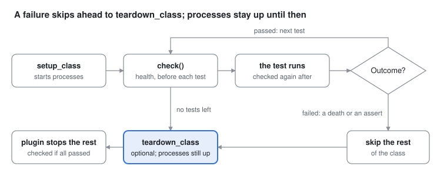

# Testing with libtmux_easy

libtmux_easy ships a pytest plugin for testing a system made of processes:
servers, ROS nodes, simulators, anything you start from a shell. A test
starts the processes it needs, talks to them, and checks what they do.

The plugin watches every process the whole time. **If a process dies, or
prints a line you said is bad, the test that was running fails**, even if
it never looked. Output that would scroll past in a terminal ends up in a
log file per process, and pytest's output stays readable.

The quickest way in is the tour:
[demos/pytest/basic/test_tour.py](demos/pytest/basic/test_tour.py). Each
test there shows one feature, with comments. Run it:

```bash
pytest demos/pytest/basic/test_tour.py -v            # processes run in the background
pytest demos/pytest/basic/test_tour.py -v --tmux     # watch them in a tmux dashboard
LTE_DEMO_CRASH=1 pytest demos/pytest/basic/test_tour.py -v   # see a process die mid-test
```

## A first test

Turn the plugin on in `conftest.py`, then write a test class:

```python
# conftest.py
pytest_plugins = ["libtmux_easy.testing"]

# test_web.py
import urllib.request
from libtmux_easy.testing import Processes

class TestWeb:
    @classmethod
    def setup_class(cls):
        cls.procs = Processes(cls, fail_on_output=r"Traceback")
        cls.web = cls.procs.start("servers:web", "python3 -m http.server 8000",
                                  ready=r"Serving HTTP")

    def test_serves(self):
        m = self.web.mark()
        urllib.request.urlopen("http://127.0.0.1:8000/")
        self.web.wait_for_line(r"GET / HTTP", since=m)
```

- `setup_class` runs once and starts the system. `ready=` waits for a line
  of output before going on.
- Each test uses the processes. Anything the tests share goes on `cls`.
- After the last test, the plugin stops everything. A process that doesn't
  stop cleanly on Ctrl-C (exit 0) fails the run. You don't need a
  `teardown_class`.

## What happens when



| moment | the plugin |
|---|---|
| before each test | checks every process. Something died? The test errors without running |
| during a test | records deaths and bad lines. Waits (`wait_for_line`, `wait_for_condition`) fail at once if something died |
| after each test | checks again. A death fails *this* test, not a later one |
| a test fails | skips the rest of the class. The processes **stay up**, so `teardown_class` can look at a live system |
| after the last test | runs your `teardown_class`, if any, then stops whatever is left |

After a failure, nothing reports how processes stopped. The system may be
broken, so the output stays on the failure that matters.

## Waiting for things

| you want | call |
|---|---|
| a line of output, printed already or later | `p.wait_for_line(r"listening on (\d+)")`: returns the line; `m[1]` is the group |
| only a line printed after some action | `m = p.mark()`, act, `p.wait_for_line(r"GET /", since=m)` |
| lines in order | `one = p.wait_for_line("one")`, then `p.wait_for_line("two", since=one)` |
| a line from any process | `procs.wait_for_line("*", r"ERROR")` |
| anything else (a reply, a file, a topic) | `procs.wait_for_condition(fn, timeout=10)` |
| a process that finishes on its own | `start(..., exits=0)`, then `p.wait_for_exit()` |

## Stopping and restarting

```python
p.stop(); p.start()                  # restart, same command
p.start("./server --fast")           # or a new one
procs.stop("sim:*")                  # a glob: every match, at once
procs.stop_all()                     # everything still running
```

The group stays usable after any of these. For a shutdown order of your
own, write a `teardown_class`; the plugin stops whatever you leave:

```python
@classmethod
def teardown_class(cls):
    if cls.procs.failed:             # e.g. "test_serves failed: assert ..."
        print("still up after the failure:", cls.procs.names)
    cls.procs.stop("robot:*")        # these first
    cls.procs.stop_all()             # then the rest
```

## Deciding what counts as a failure

| situation | how |
|---|---|
| a line that means trouble | `fail_on_output=r"Traceback"`, or a function `line -> message or None` |
| only for some processes | `Only(r"ERROR", name="workers:*")` in the group's `fail_on_output` |
| a process exits non-zero on Ctrl-C, and that's fine | `allowed_exit_codes=130` (per group, per `start()`, or `Only(...)`) |
| you don't care how a process ends | `allowed_exit_codes=ANY_EXIT` |
| a crash you cause on purpose | `with procs.expect_exit("w:x"): p.kill()` |
| a long test that should fail fast | call `check_health()` in its loop |

## Where processes run

| flag | processes run as | you see |
|---|---|---|
| (none) | background subprocesses | pytest's output; each process's output in its log |
| `--echo 'web*'` | background subprocesses | also the output of matching processes |
| `--tmux` | tmux panes, attached | a dashboard of every process, live |
| `--tmux --no-attach` | a detached tmux session | `tmux attach -t ...` is printed |
| `--keep-open` | as `--tmux`, never stopped | everything stays up after the run, to poke at |

The test code is the same in every mode. Logs are listed at the end of the
run (`process logs: ...`).

## More

| | |
|---|---|
| [demos/pytest](demos/pytest) | every demo: per-test processes, session scripts, the dashboard |
| [docs/pytest-plugin.md](docs/pytest-plugin.md) | the full reference: every argument, method and rule |
| [docs/testing-scripts.md](docs/testing-scripts.md) | testing a tmux session script as it is |
| [docs/processes.md](docs/processes.md) | the same process group without pytest, for programs |
| `lte_launch_test` | a separate project: ROS 2 testing on top of this plugin |
