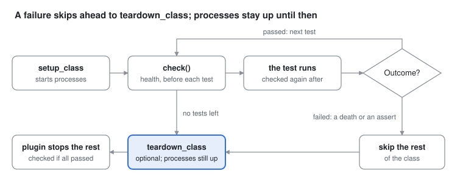

# pytest plugin (`libtmux_easy.testing`)

A `launch_testing` replacement: a test brings up the processes it needs,
talks to them, and **a process that dies fails the test**. Every process is
a shell command. The plain-language overview: [TESTING.md](../TESTING.md).
Demos: [demos/pytest](../demos/pytest); tests: `test/pytest/`. ROS 2 lives in a
separate project, `lte_launch_test`, built on this.

```python
# conftest.py
pytest_plugins = ["libtmux_easy.testing"]

# test_system.py
from libtmux_easy.testing import Processes, check_health

class TestSystem:
    @classmethod
    def setup_class(cls):
        cls.procs = Processes(cls, fail_on_output=r"Traceback")   # empty; logs in a tmp dir
        cls.procs.start("sim:server", "./server", ready=r"listening")
        cls.procs.wait_for_condition(server_answers, timeout=30)   # a gate: any code
        cls.procs.start("test:client", "./client")
        cls.procs.start("test:migrate", "./migrate", exits=0)  # finishes on its own

    @classmethod
    def teardown_class(cls):                  # optional: the plugin stops the rest after it
        cls.procs.stop("test:*")              # your order first
        cls.procs.stop_all()                  # fail unless each stops cleanly

    def test_long(self):
        while running():
            check_health()                    # a death fails it now

    def test_helper(self):
        with Processes() as procs:            # processes for this test only
            probe = procs.start("tools:probe", "./probe", ready=r"up")
            probe.wait_for_line(r"done")           # start() returns a Process handle
```

## Options

| option | processes run as | you see |
|---|---|---|
| (none) | subprocesses | test output; process output only in the logs |
| `--tmux` | panes under `lte-session` (pytest reruns itself there), attached | the dashboard; test output in the home pane |
| `--tmux --no-attach` | panes in a detached session `lte_test_<pid>`, kept on failure | test output; `tmux attach -t ...` is printed |
| `--keep-open` | as `--tmux`; stops after the tests (`teardown_class`'s, the plugin's) do nothing | inspect after the run |
| `--arg NAME=VALUE` | | read with `arg(NAME, default)`, typed like the default; repeatable |
| `--echo PATTERN` | subprocesses | also the output of processes whose `window:name` matches (fnmatch), prefixed `[window:name]`; `'*'`: all; repeatable |

`--no-attach` and `--keep-open` imply `--tmux`. Without a terminal (CI),
`--tmux` is `--tmux --no-attach`. Under `lte-session`, processes always
join its session and dashboard.

## Declaring processes

| where | owner | stopped |
|---|---|---|
| `Processes(cls, ...)` in `setup_class` | the class | by the plugin after `teardown_class` (checked unless a test failed); `teardown_class` may stop some first |
| `with Processes(...) as procs:` in a test | the test | at the end of the `with` (checked); without `with`, after the test; a failed test's: at once, unchecked |

One class, the same arguments, nothing to import but `Processes`; no
fixtures. Outside a test and without an owner (a fixture, `setup_class`),
`Processes()` raises `TypeError`.

**Names** are `window:pane`; a name without `:` gets a window of its own.
They are unique within a class: a test's group can't start a name the
class's group has (`ValueError: ... is taken`). tmux windows are
`<Class>/<window>`, shared by the class's groups, or `<test>/<window>` for
a test outside a class; `#N` is added if a class name is taken.

`@parametrize("rate", [5, 10])` on a class runs it all, `setup_class` to
`teardown_class`, once per value: `TestX[rate=5]`, `TestX[rate=10]`, the
value as `cls.rate`. Several names (`"a, b"`, tuples) or stacked
decorators multiply.

## How a test class runs

pytest runs a class like this (*verified*, pytest 9):

```
setup_class(cls)        once, before the first test
for each test:
                        the plugin checks every group (a death: test_x errors)
    t = TestX()         a NEW instance for every test
    t.test_x()
                        the plugin checks every group (a death fails test_x)
teardown_class(cls)     once, after the last test
                        the plugin stops what still runs
```

| rule | so |
|---|---|
| a new instance per test | state for the class goes on `cls` in `setup_class` (`cls.procs = ...`); `self.procs` in a test reads that class attribute |
| `self.x = ...` in a test lives on that test's instance | gone by the next test; don't use it to pass things between tests |
| shared objects stay shared | `self.procs.stop()` / `start()` in one test changes what later tests see. Tests run in file order |
| no `__init__` | pytest doesn't collect a class that has one |
| `setup_class` takes no fixtures | the plugin finds its config and temp dirs itself: `Processes(cls)` needs only the class |
| `setup_class` raises | every test in the class ERRORs; pytest skips `teardown_class`; the plugin stops what was started, unchecked, when the class ends |
| a test fails | its remaining tests are SKIPPED; the processes stay up until `teardown_class` (see Failure flow) |
| no `teardown_class` | fine: the plugin stops the group after the last test, checked unless a test failed |

pytest runs the two methods as a class-scoped fixture internally. We use
them, not a fixture, because they read as plain Python: two named
methods, no decorators, no `yield`.

## `Processes`

`Processes(owner=None, *, fail_on_output=None, allowed_exit_codes=None, log_dir=None, sigint_timeout=5, sigterm_timeout=5, env=None)`

Tests use this one. `libtmux_easy.processes.ProcessGroup` is the engine it
subclasses, for programs that aren't tests ([processes.md](processes.md)):
same methods, no test owner, mode set by `tmux=`.

| argument | meaning |
|---|---|
| `owner` | the test class (`cls` in `setup_class`); none in a test: that test. A failed test of a class skips the rest of it |
| `fail_on_output` | stdout/stderr output that fails a process while it runs: a check for every process, an `Only(...)` rule for some, or a list of both. A check is a regex (string, or compiled for flags), searched in each line, or a function `line -> problem message or None`. A hit is a death. E.g. `[r"Traceback", Only(launch_death(), cmd="*ros2 launch*")]` |
| `allowed_exit_codes` | nonzero exit codes a process may end with when stopped; 0 always may. An int for every process, an `Only(...)` rule for some, or a list of both. Death by signal N is 128+N: `130` allows SIGINT. `ANY_EXIT` (or `"any"`): any end is clean |
| `sigint_timeout` | seconds SIGINT gets before SIGTERM |
| `sigterm_timeout` | seconds SIGTERM then gets before SIGKILL |
| `log_dir` | where the logs go; default `<basetemp>/<Class>N/`, `<Class>.<test>N/` or `<test>N/` |
| `env` | variables for each of its processes (None unsets); `start(env=)` wins. The group's only: never `os.environ` ([processes.md](processes.md#environment)) |

| method | does |
|---|---|
| `start(name, cmd, *, ready=, ready_timeout=30, fail_on_output=, exits=, allowed_exit_codes=, env=, sigint_timeout=, sigterm_timeout=)` | start; returns a `Process`. `ready`: wait for a matching line. `fail_on_output`, `allowed_exit_codes`: more for it, on top of the group's; plain values, no `Only`. `exits`: codes it may finish with on its own (no death). `env`: variables on top of the group's `env=` and its environment. `sigint_timeout`, `sigterm_timeout`: its own SIGINT and SIGTERM grace when stopped, kept on a restart |
| `stop(name, *, check=True, sigint_timeout=, sigterm_timeout=)` | SIGINT, then SIGTERM, SIGKILL; the timeouts default to `start()`'s, else the group's; `check`: fail unless it stopped cleanly. A glob (`"sim:*"`) stops every running match at once and returns `{name: PaneStatus}` |
| `stop_all(check=True)` | `stop()` on everything still running, in parallel. The group stays usable |
| `failed` | why a test of the owner failed (`"test_x failed: assert ..."`), or `None`; stops aren't checked then |
| `wait_for_line(name, regex, timeout, since=)` | a line matching, printed already or later (a `LineMatch`: `.line`, `m[1]`); `since`: only after a `mark()` or an earlier `LineMatch`; name `"*"`: any process |
| `mark(name)` | where its output is now, for `since=`: mark, act, wait |
| `wait_for_exit(name, timeout)` | an `exits=` process finishing; fails on a wrong code |
| `wait_for_condition(fn, timeout)` | `fn()` until truthy, checking health between calls |
| `output(name)`, `log(name)`, `status(name)` | what it printed (latest start), its log file, its `PaneStatus` |
| `check()` | raise if anything died or hit `fail_on_output` since the last check |
| `build(fn, ..., exits=)`, `adopt(cmd, ...)` | a session script's processes: see below |
| `procs["window:pane"]` | its `Process` |
| `kill(name)` | SIGKILL: a death, unless in `expect_exit` |
| `with expect_exit(name, timeout=10):` | an exit you cause on purpose (a kill, a bad input) is no death; fails if it hasn't exited by the end |

`Process`, from `start()` or `procs[name]`: the methods above for its name,
without it: `stop()`, `kill()`, `wait_for_line(regex)`, `mark()`,
`wait_for_exit()`, `output()`, `log()`, `status()`, and `.name`;
`start(cmd=None)` starts it again with the same options, and the same
command unless given a new one. It follows the name, so it stays valid
after a stop and a new start.

### Targeting: `Only`

`Only(value, name="*", cmd=None)`: `value` (what `start()` would take)
for only the processes both globs match.

```python
from libtmux_easy.testing import ANY_EXIT, Only, Processes

Processes(cls,
    fail_on_output=[
        r"Traceback",                                   # every process
        Only(launch_death(), cmd="*ros2 launch*"),  # launch processes
        Only(r"(?i)fatal", name="sim:*"),               # the sim window's panes
        Only([r"ERROR", too_slow], name="sim:server"),  # one process, two checks
    ],
    allowed_exit_codes=[130, Only({2, 3}, name="pub:*"), Only(ANY_EXIT, name="bag:*")],
)
procs.start("sim:client", "./client", fail_on_output=r"refused", allowed_exit_codes=2)

def too_slow(line):                                     # a message for a bad line, else None
    m = re.search(r"latency (\d+) ms", line)
    return f"latency {m[1]} ms > 100" if m and int(m[1]) > 100 else None
```

| argument | group (`Processes`, `ProcessGroup`) | `start()` |
|---|---|---|
| `fail_on_output` | `OneOrMany[Union[Match, Only[OneOrMany[Match]]]]` | `OneOrMany[Match]` |
| `allowed_exit_codes` | `OneOrMany[Union[int, Only[ExitCodes]]]` | `ExitCodes` |

- `Match`: a regex (string, or compiled for its flags; no faster) or a
  function `line -> message or None`. `ExitCodes`: an int, several, or
  `ANY_EXIT`.
- `name` globs `window:pane` (`"sim:*"`, `"*:server"`), as `--echo` does.
  `command` globs the command given to `start()`: `"*ros2 launch*"`, since
  the executable is `ros2` or `python3`.
- An adopted pane's command is the command line it runs (from `/proc`),
  which may differ from what the script typed: glob `"*ros2 launch*"`, not
  `"ros2 launch*"`. `adopt()` prints each pane's.
- Rules are picked once, when a process starts: nothing per line.
- **Everything adds up**: plain values, every rule that applies, and
  `start()`'s. 0 is always allowed.
- **Wrong types fail at once**: an `Only` given to `start()`, or a
  `{"*": ...}` dict, raises `TypeError` with an example of the right form.

## Testing a session script

A session script brings a system up in tmux, like a `ros2 launch` file.
Full guide: [testing-scripts.md](testing-scripts.md).

| method | the test | demo |
|---|---|---|
| 1. layout | `start()` each of the script's `panes()` | `demos/pytest/script_layout` |
| 2. build | `procs.build(launch.build)`: the script's `build(session)` on the run's session | `demos/pytest/script_build` |
| 3. adopt | `procs.adopt("python3 launch.py")`: run it as it is, on a tmux server of its own; every pane it made is a process | `demos/pytest/script_adopt` |

Module functions: `check_health()` (every open group), `arg(name,
default)`, `parametrize(names, values)`.

## Failure flow



| when | what | outcome |
|---|---|---|
| a process exits, not stopped and not an expected `exits=` code | recorded (exit watch) | a death |
| a `fail_on_output` hit | recorded (output watch) | a death |
| before each test, after `setup_class` and fixtures | `pytest_runtest_setup` checks every open group | the test ERRORs without running |
| in the test: `check()`, `check_health()`, `wait_for_condition`, `wait_for*` | checked | FAILED now |
| after each test | `pytest_runtest_call` checks every open group | FAILED, with the last output and the log's path |
| a test (or its setup) fails | `pytest_runtest_makereport` sets `procs.failed`; the test's own groups stop at once, unchecked | the rest of the class SKIPPED; the class's processes stay up |
| after the last test | `teardown_class`, then the plugin's `close()` | ERROR at the last test's teardown unless each stopped cleanly; nothing is checked after a failure |

Each problem is reported once, by the first check after it happened.

**After a failure, nothing reports unclean exits**: not `stop()`, not
`stop_all()`, not the plugin's stop. The system may be broken; the output
stays on the failure. `procs.failed` says why the first failed test failed
(`"test_x failed: assert 1 == 2"`, `"test_x failed: sim:server died"`), or
`None`:

```python
@classmethod
def teardown_class(cls):
    if cls.procs.failed:                         # still running: look around
        subprocess.run(["ros2", "node", "list"])
    cls.procs.stop("robot:*")                    # your order first
    cls.procs.stop_all()                         # then the rest
```

| `teardown_class` | the plugin, after it |
|---|---|
| calls `stop_all()` | nothing left to stop |
| defined, stops some or none | stops the rest, checked unless a test failed |
| not defined | stops all, checked unless a test failed |
| `setup_class` raised | stops all, unchecked |

## Stopping

| call | which | how | checked |
|---|---|---|---|
| `stop(name)` / `p.stop()` | one | SIGINT, then SIGTERM, then SIGKILL, each after its grace | yes |
| `stop("sim:*")` | every running match, in parallel | same | yes, one failure listing each |
| `stop_all()` | everything still running, in parallel | same | yes |
| `kill(name)` | one | SIGKILL now | a death, unless in `expect_exit()` |

- **Checked** means: SIGINT was enough, the code is allowed, and no
  `fail_on_output` line came while stopping. Off for one call:
  `check=False`. Off for some processes: `allowed_exit_codes=ANY_EXIT`
  (any code, any way of stopping; a death during the tests still fails).
- **The group stays usable**: `start()` after any stop. `p.start()` reruns
  the same command, `p.start("./new")` a new one; output starts fresh.
- **A glob** matching nothing raises `ValueError`; already stopped or exited
  processes are left out.
- **Order**: `stop_all()` stops everything at once. Stop the first ones in
  `teardown_class`; no `stop_order=`, no reverse-start default.
- **The end of a group** is done for you: by the plugin after
  `teardown_class`, for a test's group at the end of its `with`. It drops
  the group from health checks, frees its names, and kills `adopt()`'s tmux
  server (kept after a failure). `start()` is refused after it. Programs
  call it themselves: `ProcessGroup.close()` ([processes.md](processes.md)).
- **`--keep-open`**: stops in `teardown_class` and the plugin's do nothing.
  Stops inside tests still work.
- `kill_all()` (SIGKILL everything now) is for programs on `ProcessGroup`,
  e.g. lte_launch's second Ctrl-C; tests don't need it.

## Failure messages

A first line naming the process and what went wrong, labelled lines, the
log, and for most the last 8 lines of output.

| first line | from | labelled lines |
|---|---|---|
| `sim:server died` | an exit nobody asked for | `exit:` (and `expected:` for `exits=`) |
| `sim:server failed an output check` | a `fail_on_output` hit | `line:`, then `matched: r'...'` or `check:` and `msg:` |
| `... failed an output check (while stopping)` | a hit during a stop | as above |
| `sim:server did not stop cleanly` | a checked stop | `stopped: SIGINT`, `exit: 3 (allowed: 0, 130)` |
| `sim:server printed no matching line` | `ready=`, `wait_for_line()` | `wanted: r'listening' (within 30 s)`; with `since=`: `, after 'one'` or `, after the mark: line 12 on` |
| `sim:server exited before a matching line` | a wait | `wanted:`, `exit:` |
| `sim:server still running` | `wait_for_exit()`, `expect_exit()` | `waited: 10 s for its exit` |
| `timed out waiting for server_answers` | `wait_for_condition()` | `waited: 10 s` |
| `./start.sh made no tmux panes` | `adopt()` | |

```
sim:server failed an output check
  command: ./server --port 9000
  line:    'step 812: latency 250 ms'
  check:   too_slow
  msg:     latency 250 ms > 100
  log:     /tmp/.../sim_server.log
```

When SIGINT was not enough: `stopped: SIGTERM (no exit 5 s after SIGINT)`,
`exit: killed by signal 15`. A function check's name is its `__qualname__`
without `.<locals>`: `launch_death.check`, `test_x.too_slow`, `<lambda>`.
`TmuxSession.wait_for_output()` raises plain `TimeoutError` / `PaneExited`,
one line, same wording.

## Logs

Each process's output, as plain text, goes to `<window>.<name>.log` in
the group's `log_dir`.
The summary prints `process logs: <dir>`; a death's report names the file.
Each process gets `LTE_LOG_DIR`, its log's directory (e.g. for a tool's
own logs).

## Hook for the app

| fixture | scope | default | use |
|---|---|---|---|
| `lte_pane_setup` | session | `None` | shell command before each process (`cd`, `export`) |

Processes get exactly pytest's environment, then the group's `env=`, then
`start(env=)`, in every mode (tmux panes: see `environment.md`), minus `BASH_ENV`: a container's that sources ROS would
drop the overlay.

## Design

- **Modes.** `subprocess` (default), `tmux` (a detached session), `dash`
  (under lte-session). Chosen in `pytest_configure` from the flags; not an
  option of its own.
- **Backends.** `_SubprocessBackend`: `Popen(["bash", "-c", cmd])` per
  process, a reader thread (plain text, log, `fail_on_output`, `--echo`) and a
  waiter thread (exit). `_TmuxBackend`: wrap-mode panes (`cmd_capture=<log>`,
  i.e. `lte-run --tee`), exit and output watches from `TmuxSession`. The session has
  `wait_start=False`: `start()` returns at once and all rc files run in
  parallel; a process is `starting` until lte-run reports (docs/wrap-mode.md).
  `Processes` holds
  what is common: names, `_Run` per start (stopping, died, finished),
  deaths, `fail_on_output` hits, report-once counters.
- **Reading output.** Subprocess: the reader's lines. tmux: the
  `cmd_capture` log, not a pane capture, which also holds the shell's
  prompt and the typed command. Each start rewrites it, so it holds the
  latest start ([output.md](output.md)).
- **One registry.** Every open group is in `_open`; `check_health()`
  and the hooks walk it, so helpers deep in test code need no handle.
  `Processes()` works outside fixtures through `_plugin`, filled by a
  session autouse fixture before any `setup_class`.
- **Ownership.** A group's `owner` (the class, or the test item) decides
  whose failure sets its `failed` and which tests are skipped after.
  `Processes()` finds its test through `pytest_runtest_call`, which records
  the running item and, after a passing test, closes (and checks) the
  test's groups still open. `pytest_runtest_teardown` marks a class's groups
  as ending before its last test's teardown (so `--keep-open` turns
  `teardown_class`'s stops into no-ops), then closes them after it.
- **`--tmux` attach.** `pytest_cmdline_main` (tryfirst) execs
  `python -m libtmux_easy.lte_session -- python -m pytest <same args>`. pytest
  already captures fds 0-2 there: the tty check uses `/dev/tty` and the
  foreground process group, and capture (stdin included) is suspended
  before the exec so the new process gets the real terminal.
- **`parametrize`.** A `pytest_pycollect_makeitem` hook turns a marked class
  into one `pytest.Class` node per value, each over a subclass with the
  values as attributes (`_ParametrizedClass._getobj`: pytest 9 looks a
  class up in its module by name otherwise). Each value's subclass is its
  own owner, so a failure at one value doesn't skip the others.
- **Concurrency.** Sessions are `lte_test_<pid>` (`-N` if taken, never
  killed); window prefixes get `#N` if taken. Ports and fixed paths are the
  test's job (derive them from `os.getpid()`).

## Subprocesses: signals (*verified*, ROS 2 Jazzy)

- `ros2 launch` with a non-tty stdin is "noninteractive" and re-sends SIGINT
  to children that already got the group's. Python nodes die (-2) of the
  second. `ros2 run` doesn't forward SIGINT at all.
- So each process runs with `start_new_session` and a **pty for stdin**, and
  is stopped with `killpg`: SIGINT, then SIGTERM (`sigterm_timeout`, 5 s),
  then SIGKILL (2 s).
- `ros2 launch` exits 0 on SIGINT and keeps running after a child dies; the
  only record is `[ERROR] [name-N]: process has died [pid P, exit code C`.
  Hence `fail_on_output` functions (`lte_launch_test.launch_death`).
- A bare `rclpy.spin()` dies *by* SIGINT; catch `KeyboardInterrupt` /
  `ExternalShutdownException` to exit 0, or allow 130 in `allowed_exit_codes`.
